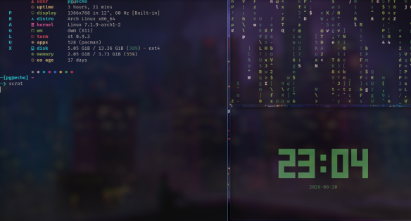
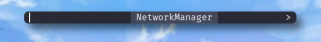

## Screenshots


### Terminal



### dwm-bar


### Dmenu




## Installation
```bash
git clone https://github.com/praglux/dotfiles.git ~/dotfiles
cd ~/dotfiles
chmod +x install.sh
./install.sh
```
## Package 
  File Manager : yazi 
  terminal     : kitty , st
  Browser      : firefox 
  package      : eza , picom , fastfetch 
